 

## Sobre mim

## Tecnologias

## Projetos

<b>Detalhes do projeto</b>

 

- Consulta a base de documentos e protocolos internos para responder dúvidas de novos colaboradores
- Respostas objetivas, fundamentadas nos documentos disponíveis
- Reduz dúvidas repetitivas e facilita o acesso ao conhecimento interno

 

<b>Detalhes do projeto</b>

 

- Trilha de lições, vídeos de sinais, exercícios, quizzes e sequência diária de estudos
- Atividade com câmera que verifica se o sinal feito corresponde à letra esperada
- Frontend em HTML, CSS e JavaScript; API em Node.js com Express e banco MongoDB Atlas
- Teste com usuários: 75% avaliaram a correção de sinais pela câmera como muito satisfatória
- Desenvolvido em equipe de cinco integrantes na ETEC Dr. Júlio Cardoso

[Acessar a plataforma](https://www.librandotcc.com.br/) · [Ver repositório](https://github.com/JoaoRacero0805/Librando)

 

<b>Detalhes do projeto</b>

 

- Roda nos servidores do Google, sem precisar de computador ligado ou ação manual
- E-mail ordenado do pedido mais antigo ao mais novo, com destaque para os atrasados
- Dados sensíveis (e-mails, IDs de planilha) ficam nas propriedades do script, fora do código

[Ver repositório](https://github.com/JoaoRacero0805/LembreteCancelamentoMAGALU)

 

